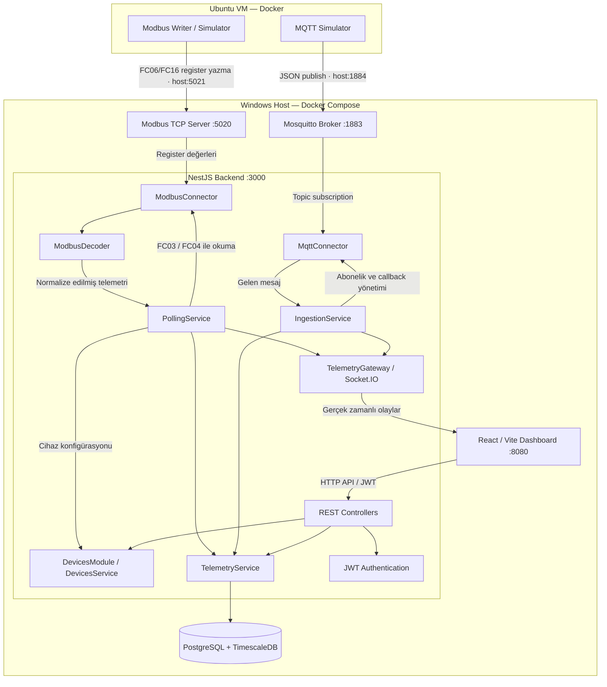

# FactorEdge — Akıllı Fabrika IoT İzleme Platformu

FactorEdge, endüstriyel makinelerden **Modbus TCP** ve **MQTT** üzerinden telemetri toplayan, verileri ortak bir modele dönüştüren, **TimescaleDB** üzerinde saklayan ve **React** panelinde **Socket.IO** ile gerçek zamanlı gösteren bir demo platformudur.

> **Kapsam:** Teknik değerlendirme için geliştirilmiş bir prototiptir; üretim ortamı için sertifikalı bir endüstriyel kontrol sistemi değildir. Aşağıdaki adresler ve portlar kullanılan yerel demo ortamına aittir.

## 1. Kurulum ve çalıştırma adımları

### Teknolojiler ve ön koşullar

- **Windows host:** Docker Desktop + Docker Compose; NestJS backend, React frontend, PostgreSQL/TimescaleDB, Mosquitto ve Modbus TCP Server.
- **Ubuntu VM:** Docker Engine + Docker Compose; Modbus Writer ve MQTT Simulator.
- Ubuntu VM ile Windows host arasında ağ erişimi ve projeye ait yerel `.env` yapılandırmaları gerekir.

### Windows — platform servisleri

Proje kökünde PowerShell açın:

```powershell
docker compose up -d --build
docker compose ps
```

Uygulama arayüzü: **http://localhost:8080**  
Backend API: **http://localhost:3000** (Compose port eşlemesine bağlıdır).

Demo ağında Windows host üzerindeki dış portlar:

| Servis | Ubuntu'dan erişim | Docker ağı içinden erişim |
| --- | --- | --- |
| Modbus TCP Server | `10.0.2.2:5021` | `modbus-server:5020` |
| MQTT / Mosquitto | `10.0.2.2:1884` | `mosquitto:1883` |

`10.0.2.2` VirtualBox NAT yapılandırmasına özgüdür; farklı ağlarda host adresini değiştirin.

### Ubuntu — simülatörler

```bash
cd /home/factoredge/factoredge
docker compose up -d
docker compose ps
docker compose logs --tail=30 modbus-writer
docker compose logs --tail=30 mqtt-simulator
```

Simülatörlerin kendi `config.json` dosyalarında makine durumu ve bağlantı bilgileri tutulur:

**Modbus (`modbus-simulator/config.json`):**

```json
{
  "machineStatus": "RUNNING",
  "host": "10.0.2.2",
  "port": 5021,
  "unitId": 1
}
```

**MQTT (`mqtt-simulator/config.json`):**

```json
{
  "machineStatus": "RUNNING",
  "brokerUrl": "mqtt://10.0.2.2:1884",
  "topic": "factory/line2/telemetry"
}
```

`machineStatus`: `RUNNING`, `STOPPED` veya `FAULT`. Bu değerler uygulama başlarken okunur. Mevcut Dockerfile'lar `config.json` dosyasını imaj içine kopyaladığından, değişiklikten sonra ilgili imajı **yeniden oluşturmak** gerekir:

```bash
cd /home/factoredge/factoredge/modbus-simulator
docker build -t factoredge-modbus-writer:1.0 .
docker compose up -d --force-recreate modbus-writer

cd /home/factoredge/factoredge/mqtt-simulator
docker build -t factoredge-mqtt-simulator:1.0 .
docker compose up -d --force-recreate mqtt-simulator
```

İki simülatörün çalıştığını Dashboard üzerinden doğrulayın. Cihazların `CONNECTED` görünmesi, telemetri alanlarının güncellenmesi ve geçmiş grafiğin oluşması beklenir. Giriş için uygulamanın yapılandırılmış kullanıcı hesabını kullanın; parolaları README'ye eklemeyin.

> **Veri güvenliği:** `docker compose down -v` komutunu rutin durdurma için kullanmayın; TimescaleDB dahil kalıcı volume'ları silebilir.

## 2. Mimari tasarım: bileşenler ve veri akışı

### 2.1 Genel sistem mimarisi

FactorEdge iki ayrı çalışma ortamından oluşur: **Ubuntu VM** üzerinde çalışan makine simülatörleri ve **Windows Docker Compose** üzerinde çalışan veri toplama, depolama ve sunum servisleri. Backend, **NestJS modülleri** halinde ayrılmış bir uygulamadır; aşağıdaki kutular ayrı mikroservisler değil, aynı backend içindeki mantıksal bileşenlerdir.



> **Not:** Diyagramdaki `:5021` ve `:1884`, Ubuntu'nun Windows host'a eriştiği portlardır. Docker iç ağında Modbus `5020`, Mosquitto `1883` kullanır. `10.0.2.2` demo VirtualBox NAT adresidir.

### 2.2 Katmanlar ve sorumluluklar

| Katman / bileşen | Teknoloji | Sorumluluk |
| --- | --- | --- |
| Makine simülasyonu | Node.js, Ubuntu Docker | Üretim, sıcaklık, akım, scrap ve durum değerlerini üretmek |
| Protokol / bağlantı | `modbus-serial`, `mqtt.js` | Modbus register okuma; MQTT broker bağlantısı ve topic aboneliği |
| Veri toplama | `PollingService`, `IngestionService` | Modbus polling ve MQTT mesaj callback akışını yönetmek |
| Çözümleme / normalizasyon | `ModbusDecoder`, MQTT mesaj işleme | Farklı kaynakları ortak Telemetry alanlarına dönüştürmek |
| İş / cihaz yönetimi | `DevicesService` | Cihaz ayarları, protokol bilgileri ve bağlantı durumunu yönetmek |
| Kalıcılık | TypeORM, PostgreSQL, TimescaleDB | Cihazları ve zaman serisi ölçümlerini saklamak |
| Gerçek zamanlı iletişim | Socket.IO Gateway | Yeni telemetriyi ve bağlantı durumlarını tarayıcıya iletmek |
| API / güvenlik | NestJS REST, JWT | Cihaz yönetimi, geçmiş sorguları ve kimlik doğrulama |
| Sunum | React, Vite | Dashboard, Device Management ve geçmiş grafikler |

### 2.3 Modbus TCP veri akışı (polling)

```text
Ubuntu Modbus Writer
    │ Her ~1 sn: register'lara veri yazar
    ▼
Windows Modbus TCP Server
    ▲ FC03 (Holding) / FC04 (Input) okuma
    │
NestJS PollingService → ModbusConnector → ModbusDecoder
    │                                   (dataType, wordOrder, scale)
    ▼
Ortak Telemetry modeli
    ├──► TelemetryService ──► TimescaleDB
    └──► TelemetryGateway ──► React Dashboard
```

`PollingService` cihaz listesindeki **MODBUS** kaynaklarını işler. `ModbusConnector` TCP bağlantısı kurar ve `registerMap` yapılandırmasına göre gerekli adresleri okur. `ModbusDecoder`, ham 16-bit register değerlerini `uint16`, `int16`, `uint32` ve `float32` tiplerine dönüştürür; `ABCD`/`CDAB` word order ve `scale` uygular. Telemetri ortak modele çevrilir, kaydedilir ve canlı yayınlanır.

**Register örnekleri:** Production `30001–30002` (FC04, `uint32`, `ABCD`); Temperature `30003–30004` (FC04, `float32`, `CDAB`); Current `30010` (FC04, `int16`, `scale=0.01`); Scrap `30020` (FC04); Status `40001` (FC03). Projede Modbus Writer'ın offset 20'ye yazdığı status, Server tarafından holding offset 0'dan okunabilir hale getirilmiştir.

### 2.4 MQTT veri akışı (publish / subscribe)

```text
Ubuntu MQTT Simulator
    │ publish: factory/line2/telemetry (JSON + timestamp)
    ▼
Mosquitto Broker
    │ topic aboneliği
    ▼
MqttConnector ──► IngestionService
                        │ Mesajı cihazla eşleştir, doğrula,
                        │ normalize et, tazeliği takip et
                        ▼
                 Ortak Telemetry modeli
                        ├──► TelemetryService ──► TimescaleDB
                        └──► TelemetryGateway ──► React Dashboard
```

MQTT tarafında Backend register okumaz; Broker'a abone olarak gelen mesajları alır. `IngestionService` callback ve cihaz bağlantı durumu akışını yönetir. Her iki protokolün sonucu aynı telemetri modeline aktarılır; böylece veritabanı ve Dashboard protokolden bağımsız çalışır.

### 2.5 Canlı veri, geçmiş veri ve bağlantı sağlığı

- **Canlı veri:** Yeni telemetri, `TelemetryGateway` üzerinden Socket.IO ile Dashboard'a iletilir.
- **Geçmiş veri:** Telemetry kayıtları TimescaleDB'de tutulur; React, REST API üzerinden geçmiş verileri sorgular ve grafik oluşturur.
- **Modbus heartbeat:** Ubuntu Writer holding register `40022` (offset `21`) sayacını artırır. TCP Server çalışmaya devam etse bile Writer durduğunda sayaç sabit kalır; Backend bu durumu tespit etmek için heartbeat tazeliğini izler.
- **MQTT stale kontrolü:** Broker bağlantısı açık olsa bile yeni mesaj gelmeyebilir. `IngestionService`, son telemetri zamanına bakarak güncelliği değerlendirir.
- **İki ayrı durum:** `RUNNING / STOPPED / FAULT` makinenin operasyonel durumudur; `CONNECTED / DISCONNECTED` ise telemetri kaynağının bağlantı/güncellik durumudur.

## 3. Veri modeli

### Device

Bir endüstriyel veri kaynağının bağlantı ve protokol yapılandırmasını tutar.

| Alan | Açıklama |
| --- | --- |
| `id` | Cihaz kimliği (UUID) |
| `name` | Görünen cihaz adı |
| `protocol` | `MODBUS` veya `MQTT` |
| `host`, `port` | Bağlantı hedefi |
| `unitId` | Modbus slave/unit kimliği (Modbus için) |
| `registerMap` | Modbus register adresleri, function code, veri tipi, word order ve scale |
| `topic` | MQTT abonelik topic'i (MQTT için) |
| `connectionStatus` | `CONNECTING`, `CONNECTED`, `DISCONNECTED` |
| `lastDataAt` | Son alınan telemetri zamanı |
| `createdAt`, `updatedAt` | Kayıt zamanları |

### Telemetry

Her örnek bir cihaza aittir; zaman serisi verisi TimescaleDB'de saklanır.

| Alan | Açıklama |
| --- | --- |
| `deviceId` | İlgili `Device` kaydı |
| `productionCount` | Toplam üretim adedi |
| `motorTemperature` | Motor sıcaklığı (°C) |
| `motorCurrent` | Motor akımı (A) |
| `scrapCount` | Hatalı üretim adedi |
| `status` | `STOPPED`, `RUNNING`, `FAULT` |
| `timestamp` | Ölçüm zamanı |

**İlişki:** `Device (1) → (N) Telemetry`. TimescaleDB zaman bazlı geçmiş sorguları için kullanılır. Dashboard güncel ölçümleri Socket.IO üzerinden, geçmişi REST API üzerinden alır.

### Modbus register map

| Alan | Mantıksal adres | FC | Tip | Word order / scale |
| --- | --- | --- | --- | --- |
| Production | 30001–30002 | 04 | `uint32` | `ABCD`, ×1 |
| Temperature | 30003–30004 | 04 | `float32` | `CDAB`, ×1 |
| Current | 30010 | 04 | `int16` | ×0.01 |
| Scrap | 30020 | 04 | `uint16` | ×1 |
| Machine status | 40001 | 03 | `uint16` | ×1 |
| Heartbeat (ek alan) | 40022 | 03 | `uint16` | ×1 |

Adresler dokümanda 1 tabanlı gösterilir; `modbus-serial` kütüphanesine okuma için sıfır tabanlı offset verilir. Örneğin `40001 → readHoldingRegisters(0, 1)`. Demo Modbus Server'ında Writer'ın status için kullandığı offset 20 ile 40001 okuması arasında özel eşleme bulunur; bu, simülatör uyumluluğu için yapılmıştır.

## 4. MQTT topic şeması ve mesaj biçimi

**Demo topic:** `factory/line2/telemetry`

Şema: `factory/{lineId}/telemetry`. Örneğin farklı hatlar `factory/line1/telemetry` ve `factory/line2/telemetry` kullanabilir. Backend'deki cihaz kaydının `topic` değeri yayın yapılan topic ile eşleşmelidir.

Ubuntu MQTT Simulator'ın yayınladığı örnek JSON:

```json
{
  "productionCount": 5021,
  "motorTemperature": 66.2,
  "motorCurrent": 13.45,
  "scrapCount": 31,
  "status": 1,
  "timestamp": "2026-10-21T08:00:00.000Z"
}
```

`status` eşlemesi: `0 = STOPPED`, `1 = RUNNING`, `2 = FAULT`. Bunlar örnek değerlerdir. `deviceId`, yayıncı JSON'undan değil, abone olunan topic ile eşleşen cihaz kaydından belirlenir; backend telemetriyi ortak modele dönüştürür. Zaman damgası ISO 8601 biçimindedir.

## 5. Verdiğimiz en önemli üç karar ve nedenleri

**Karar 1 — Protokol bağımsız ortak telemetri modeli.** Modbus'tan register, MQTT'den JSON geliyor; ancak veri saklama, API ve arayüz tek bir `Telemetry` modeliyle çalışıyor. Böylece yeni protokoller eklenirken uygulamanın diğer katmanlarını değiştirme ihtiyacı azalıyor.

**Karar 2 — Connector ile Decoder'ı ayırmak.** Connector TCP bağlantısı, register okuma veya MQTT aboneliği gibi taşıma sorumluluklarını; Decoder ise `uint32`, `float32`, `ABCD/CDAB`, scale ve status dönüşümlerini üstleniyor. Bu ayrım test edilebilirliği artırıyor ve sorunun bağlantıda mı veri yorumlamada mı olduğunu bulmayı kolaylaştırıyor.

**Karar 3 — Hem gerçek zamanlı hem geçmiş veri, ayrıca tazelik kontrolü.** Socket.IO anlık güncellemeleri, TimescaleDB geçmiş ölçümleri sağlıyor. Modbus heartbeat ve MQTT son-mesaj zamanı kontrolü, yalnızca soketin açık olmasına güvenmenin yaratacağı yanlış `CONNECTED` durumlarını azaltıyor.

## 6. Bilerek yapmadıklarımız ve nasıl yapacağımız

| Mevcut sınır / eksik | Geliştirme yaklaşımı |
| --- | --- |
| Tam otomatik test kapsamı yok | Jest ile Decoder birim testleri; sahte Modbus/MQTT kaynaklarıyla entegrasyon ve kesinti/iyileşme testleri eklemek |
| Çok sayıda Modbus cihazı için bağlantı havuzu yok | Cihaz başına bağlantı yaşam döngüsü, kontrollü paralel polling, timeout ve retry politikaları uygulamak |
| Birden fazla MQTT broker için tam bağlantı yönetimi yok | Broker bazlı client havuzu, topic abonelik yaşam döngüsü ve yeniden bağlanma yönetimi eklemek |
| Üretim seviyesinde güvenlik tamamlanmadı | Başlangıç kullanıcı parolalarını kaynak kodundan çıkarıp güvenli yapılandırma/secret yönetimine taşımak; broker kimlik doğrulama ve TLS eklemek; ADMIN/VIEWER yetkilerini uçtan uca test etmek |
| Gelişmiş operasyonel gözlemleme yok | Yapılandırılmış loglar, metrikler, health endpoint'leri, Prometheus/Grafana ve alarm mekanizmaları eklemek |
| OEE, kestirimci bakım ve büyük ölçekli event streaming yok | İhtiyaç doğarsa ayrı hesaplama servisleri ve yüksek hacimde Kafka/RabbitMQ gibi asenkron altyapılar değerlendirmek |

Bu maddeler mevcut prototipin sınırlarını açıkça belirtir; tamamlanmış özellikler olarak sunulmaz.

## 7. Yapay zekâ aracının yanlış/eksik önerisi ve bunu nasıl fark ettik

Geliştirme sırasında yapay zekâ desteğiyle oluşturulan Modbus yazma/okuma akışında **register adresi uyuşmazlığı** vardı:

- Ubuntu Modbus Writer, makine durumunu holding register **offset 20**'ye yazıyordu.
- Backend register map'i case dokümanına uygun olarak **40001**, yani holding register **offset 0** adresini okuyordu.
- Simulator `FAULT = 2` üretirken Dashboard `STOPPED` gösteriyordu.

**Nasıl fark ettik?** Simulator loglarını, `ModbusConnector.readRawData()`, `ModbusDecoder.decodeStatus()` ve `DEFAULT_MODBUS_REGISTER_MAP` kodlarını karşılaştırdık. Decoder'ın `2 → FAULT` eşlemesi doğruydu; sorun verinin farklı holding register adresinden okunmasıydı.

**Nasıl düzelttik?** Demo Modbus Server'ında Writer'ın offset 20'ye yazdığı status değerini holding offset 0 üzerinden okunabilir hale getiren eşleme ekledik. Ardından `FAULT` durumunun Dashboard'a doğru ulaştığını doğruladık.

**Öğrenim:** Yapay zekâ tarafından önerilen kodun derlenmesi veya servisin ayakta olması, protokol semantiğinin doğru olduğu anlamına gelmez. Modbus'ta **FC03/FC04 ayrımı**, **30001/40001 gösterimi** ve **sıfır tabanlı offset** mutlaka gerçek veriyle test edilmelidir.

---

### Kısa demo senaryosu

1. Windows ve Ubuntu Compose servislerini başlatın; Dashboard'da Modbus ve MQTT cihazlarını gösterin.
2. Canlı üretim, sıcaklık, akım, scrap ve status güncellemelerini izleyin.
3. Simulator `config.json` üzerinden `RUNNING`, `STOPPED`, `FAULT` durumlarını gösterin (imajı yeniden oluşturun).
4. Bir simülatörü durdurup veri tazeliği/bağlantı durumunun değişimini, ardından yeniden başlamasını gösterin.
5. Device Management üzerinden cihaz yapılandırmasını ve geçmiş grafiğini gösterin.
6. Rol yetkisi gösterimini ancak backend tarafında gerçekten doğrulandıysa gerçekleştirin.

**Not:** README'deki örnek bağlantı bilgileri yerel demo ağına özeldir. Başlangıç kullanıcı şifreleri ve diğer sırlar kaynak kodunda sabit bırakılmamalıdır; üretim kullanımından önce güvenli yapılandırma yapılmalıdır.
